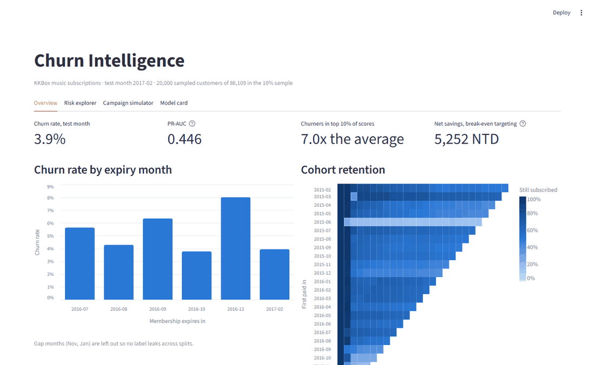
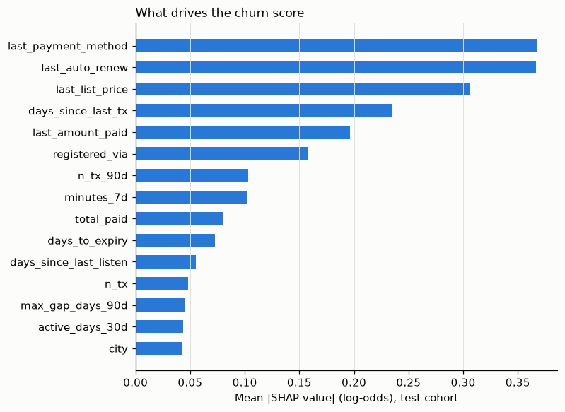
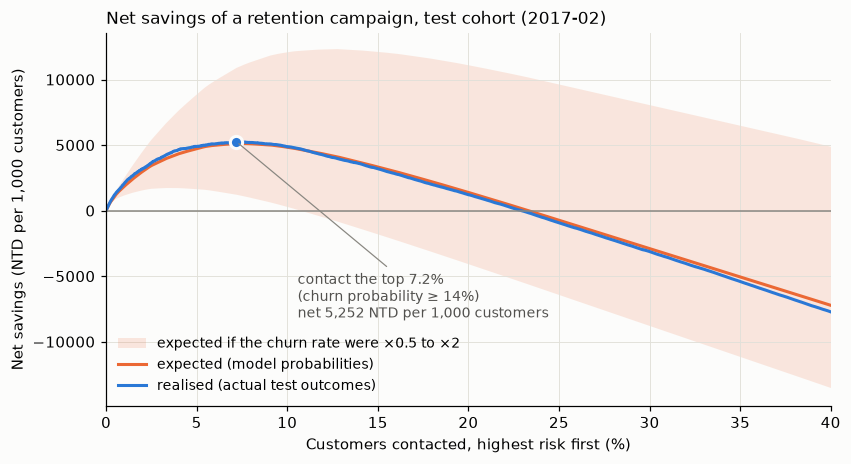
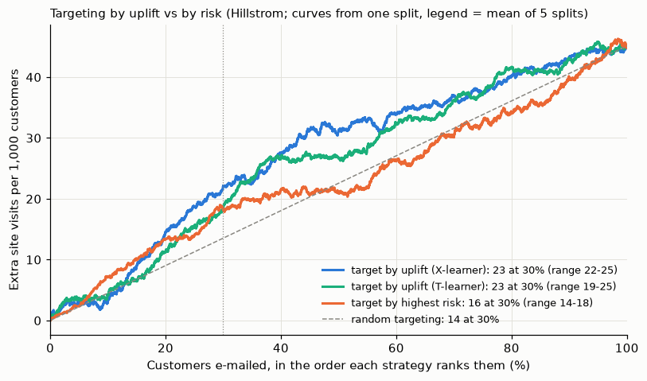
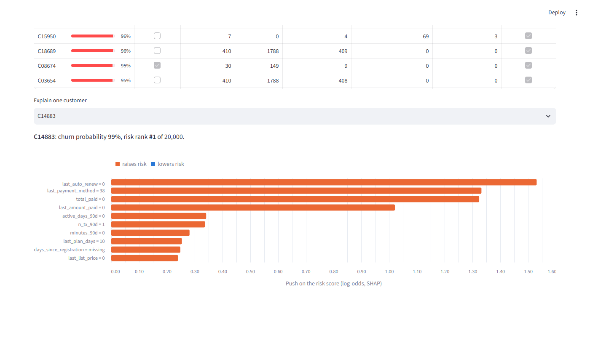
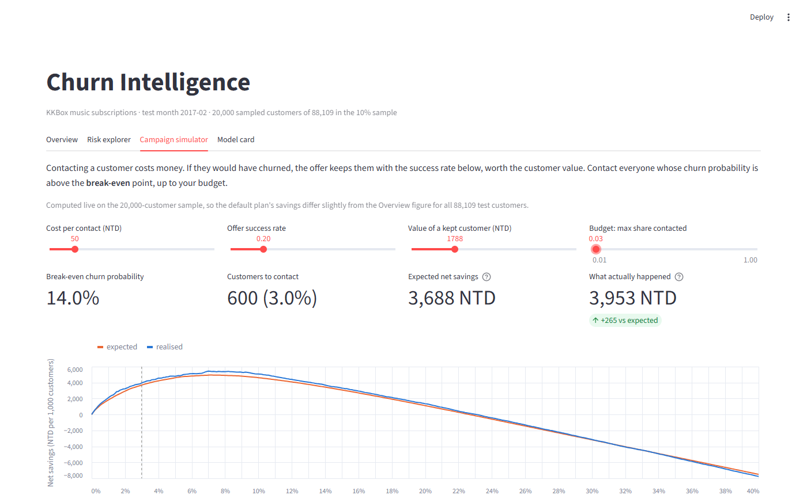

# Churn Intelligence Platform

**In one sentence:** this project looks at the customers of a music streaming service and
answers three questions: *who is about to leave, why, and who is worth spending money on to
keep?*

**[▶ Try the live app](https://churn-intelligence-platform-4dgea95k9yckwjycdlhqge.streamlit.app/)** · the live app uses *synthetic* customers, see
[why](#about-the-live-app)



You don't need any background in data science to read this page. Every term is explained
the first time it comes up, and there is a [glossary](#glossary) at the end.

---

## The problem, in plain words

Think of any subscription you pay for: Spotify, Netflix, a gym. Every month some
customers don't renew and simply leave. Businesses call this **churn**. Losing a customer
is expensive, because winning a new one usually costs much more than keeping an old one.

So a company wants to step in *before* people leave, for example by sending a discount or a
friendly email. But that has a cost too, and there are three traps:

1. **You don't know who is about to leave.** Sending a discount to *everyone* wastes money
   on the many people who were going to stay anyway.
2. **You don't know why they leave.** Without a reason, you can't pick the right fix.
3. **The people most likely to leave are not always the people you can change.** Some
   will leave whatever you do. Others would have stayed anyway. Your money only matters
   for the people in between.

This project tackles each trap in turn.

---

## What the project found

### 1. Who is about to leave?

We used real, anonymised data from **KKBox**, a large music streaming service in Taiwan
(similar to Spotify). It holds payment history, daily listening activity and basic
profile details. We used a random 10% of its customers, about 88,000 people per month.

A computer program learned from past months which patterns come before someone leaves.
This kind of program is called a **model**. We then tested it on a *later* month it had
never seen, the same way it would be used in real life.

Only about **4 in every 100** customers leave in a given month, so finding them is hard.
The results:

- **The model's top 10% "most at risk" list contains 7 out of every 10 people who actually
  left.** A random list of the same size would catch only 1 in 10.
- **Its percentages can be trusted.** On average it predicted that 3.8% of customers
  would leave, and 3.9% actually did. When it says "this person has a 30% chance of
  leaving", roughly 30 out of 100 such people really do leave.

### 2. Why do they leave?

We asked the model which facts pushed each person's risk up or down. The biggest reasons
were all about **billing**, not about how much people listen to music:

| Customers who... | Leave at | Everyone else | So they are |
|---|---|---|---|
| turned **automatic renewal off** (12% of customers) | 21.5% | 1.6% | **13× more likely to leave** |
| pay with a less common payment method (29%) | 11.1% | 1.0% | **11× more likely** |
| are on a price above 99 TWD (56%) | 6.1% | 1.2% | **5× more likely** |

*TWD is the New Taiwan dollar. 149 TWD is about 5 US dollars.*

**What a business could do with this:** the clearest warning sign is someone switching
off auto-renew. That is a moment to reach out, not a month later when they are gone.



### 3. Who is worth spending money on?

Here is the money question. Say that contacting one customer (for example, a discount
offer) costs **50 TWD**, works on **1 in 5** people it reaches, and a kept customer is
worth **one year of subscription (1,788 TWD)**.

With those numbers, contacting someone only pays off if their chance of leaving is above
**14%**. Below that, you mostly pay people who would have stayed anyway.

| Plan, per 1,000 customers | Result |
|---|---|
| Contact **everyone** | **lose** about 35,900 TWD |
| Contact the **top 10%** on the risk list | gain about 4,900 TWD |
| Contact only those **above the 14% line** (about 7%) | **gain about 5,250 TWD**, almost the best possible |



The app lets you change the cost, success rate and customer value and watch the answer
change.

### 4. Bonus: risk is not the same as "can be persuaded"

Knowing who is *likely to leave* is not the same as knowing who will *react to your
offer*. To measure the reaction you need an experiment. Some people get the offer, a
random group doesn't, and you compare the two. The KKBox data has no such experiment, so
for this part we used a second, public dataset: an email campaign by a US retailer
(the **Hillstrom** dataset, 64,000 customers). It *was* run as an experiment.

On average the email made **4.5 more people out of every 100** visit the website. But
some people react much more than others. We built a second model that predicts *how much
each person will react*, not how likely they are to act on their own. This is called an
**uplift model**.

If you can only email 30% of customers, then per 1,000 customers emailed:

| Who you email | Extra website visits |
|---|---|
| A random 30% | 13.5 |
| The 30% "most likely to act anyway" | 15.5 |
| **The 30% the uplift model expects to react most** | **23.4** |

**Choosing people by how they will react gets about 50% more out of the same budget**
than choosing them by risk.



---

## The app

All of this is in an interactive web app with four pages:

1. **Overview:** how many customers leave each month, and how long groups of customers
   who joined together tend to stay.
2. **Risk explorer:** a ranked list of customers. Click one to see *why* the model thinks
   they might leave.
3. **Campaign simulator:** sliders for budget, cost and success rate. It shows the profit
   or loss and a list of who to contact, which you can download.
4. **Model card:** an honest report on how well the model works and where it falls short.

| Overview | Why is this customer at risk? | What should we spend? |
|---|---|---|
|  |  |  |

*These screenshots were taken on the real data, on my own computer.*

### About the live app

KKBox's data comes from a Kaggle competition whose rules don't allow sharing it. So the
public app runs on **synthetic customers**: 20,000 made-up people generated to look like
the real ones. Each column has a realistic spread of values, and the columns go together
as they do in real life (for example, people who switch auto-renew off also tend to pay
less). But no row is a real customer, and we check that no fake row matches a real one.
Their "did they leave?" answers are drawn at random from the model's own predictions.

What this means for you:

- **Real:** the headline numbers, the charts, the model and the model card.
- **Synthetic:** the customer lists in the *Risk explorer* and *Campaign simulator*, and the
  "simulated outcome" figure. Patterns there are softer than in the real data. For
  example, turning auto-renew off makes a fake customer about 4× more likely to leave,
  against 13× in the real data.

To run it on your own computer, see [Run it yourself](#run-it-yourself).

---

## Honest limitations

- **Two different datasets.** The "who will leave" part uses music-streaming data. The
  "who will react" part uses a retailer's email experiment. A real company would run both
  on its own customers. We used the best public data available for each question.
- **The money figures are assumptions.** The 50 TWD cost, 1-in-5 success rate and one-year
  customer value are made-up but reasonable defaults. Change them in the app.
- **10% of customers.** We used a sample to keep the project small. Testing showed that
  more data would improve the results only a little.
- **Old data.** KKBox data ends in March 2017. Behaviour today may differ.
- **The live app's customers are synthetic.** See [above](#about-the-live-app).
- **The customer groups in the experiment are not proven.** The uplift model also sorts
  people into four groups (for example "persuadable" and "sleeping dog"). On data the
  model had not seen, these groups were not clearly different, so we report their numbers
  but don't claim them as a finding.
- **Our "who left" definition differs slightly from KKBox's own answer file.** We follow
  KKBox's *published rule* exactly. Their answer file breaks that rule in about 1,400
  cases. See [technical notes](#how-who-left-is-decided).

---

## Glossary

| Term | Meaning |
|---|---|
| **Churn** | A customer leaving: they don't renew their subscription. |
| **Churn rate** | Out of 100 customers, how many leave in a given month. |
| **Model** | A program that learns patterns from past data and uses them to make guesses about new data. |
| **Cohort** | A group of customers who share a starting point, for example everyone whose subscription ends in the same month. Comparing cohorts shows how behaviour changes over time. |
| **Retention** | The opposite of churn: the share of customers who stay. |
| **Calibrated** | The model's percentages match reality. "30% risk" means about 30 in 100 really leave. |
| **Break-even** | The point where an action stops losing money and starts making it. |
| **Uplift** | How much an action (an email, a discount) *changes* someone's behaviour, compared with doing nothing. |
| **Experiment (randomised trial)** | Splitting people at random into a group that gets the action and a group that doesn't, so any difference is caused by the action. |
| **Test month** | A month the model never saw while learning. Results on it show how the model would do in real use. |

---

## Run it yourself

*This part is for people comfortable with a terminal.*

**Just the app (about 5 minutes).** The synthetic data ships with the repo, so you only
need [uv](https://docs.astral.sh/uv/):

```bash
uv sync
uv run streamlit run app/streamlit_app.py
```

**The whole pipeline, from raw data.** You need uv, a free Kaggle account, and to accept the
[KKBox competition rules](https://www.kaggle.com/c/kkbox-churn-prediction-challenge) on
Kaggle. The full rebuild downloads about 30 GB and takes a few hours, but it never needs
more than about 16 GB of free disk at once.

```bash
uv sync                   # install everything
uv run churn download     # get the KKBox data from Kaggle
uv run churn data         # sample 10% of customers, build the "who left" answers
uv run churn features     # turn raw history into facts the model can learn from
uv run churn train        # train and test the model
uv run churn economics    # the money analysis
uv run churn explain      # the "why" analysis
uv run churn uplift       # the email experiment analysis
uv run churn bundle       # make the synthetic customers for the app
uv run churn clean-raw    # optional: delete the big raw files afterwards
uv run streamlit run app/streamlit_app.py   # open the app
```

`make all` runs the same steps, and `make app` opens the app. Run the tests with
`uv run pytest`.

---

## Technical notes

*For data scientists and engineers.*

### How "who left" is decided

A customer **churns** if they make no valid (non-cancel) renewal within 30 days after their
membership expires. This is the WSDM Cup 2018 definition. Each month *M* is scored from its
first day, the **cutoff**. The **cohort** is every customer whose membership, as known
before the cutoff, expires during *M*. Features only use data from before the cutoff.

The rule copies KKBox's official labeller `WSDMChurnLabeller.scala`, including how it orders
same-day transactions. It lives in [`sql/02_labels.sql`](sql/02_labels.sql) and is tested on
hand-built histories in [`tests/test_labels.py`](tests/test_labels.py).

Compared with KKBox's published Feb-2017 labels (`train.csv`) on our sample, we get 99.2%
precision and 71% recall. The 1,384 disagreements contradict the official script itself:

- 372 had no transaction in the month before the cutoff, so the script would never have
  selected them.
- 450 renewed onto plans of 90 days or longer.
- 549 cancelled after the cutoff, sometimes *after* a valid renewal.

We keep the script's rule and treat `train.csv` as a diagnostic.

### No peeking at the future

| Split | Cohort months |
|---|---|
| Train | 2016-07 → 2016-10 |
| *gap* | 2016-11 |
| Validation | 2016-12 |
| *gap* | 2017-01 |
| Test | 2017-02 |

The data is split by time, never at random. Each gap month exists because a month's
answer is only known 30 days later. [`config.py`](src/churn/config.py) refuses any split
without the gap.

A leakage test fills the database with fake events dated after the cutoff and checks that
no feature changes ([`tests/test_features.py`](tests/test_features.py)).

### Model and evaluation

- **Model.** LightGBM tuned with Optuna on validation PR-AUC, and logged to MLflow.
- **Calibration.** Isotonic, fitted on out-of-fold training-month scores.
- **Test results.** PR-AUC 0.446 (base rate 0.039), ROC-AUC 0.871, lift@10% 7.0×,
  Brier 0.028. A logistic-regression baseline reaches PR-AUC 0.382.
- **Explanations.** Per-customer explanations use LightGBM's built-in SHAP values.
- **Uplift.** T- and X-learners, evaluated on the Hillstrom women's-email arm vs. control
  with a 70/30 split over 5 seeds, using Qini curves and observed uplift by predicted fifth.

### Where things live

```
sql/         DuckDB SQL: raw ingest, labels, leakage-safe features
src/churn/   pipeline code (data, features, models, eval, explain, bundle, CLI)
app/         Streamlit app and its requirements
tests/       labels, splits, leakage, metrics, economics, uplift, app smoke test
notebooks/   exploration only
```
